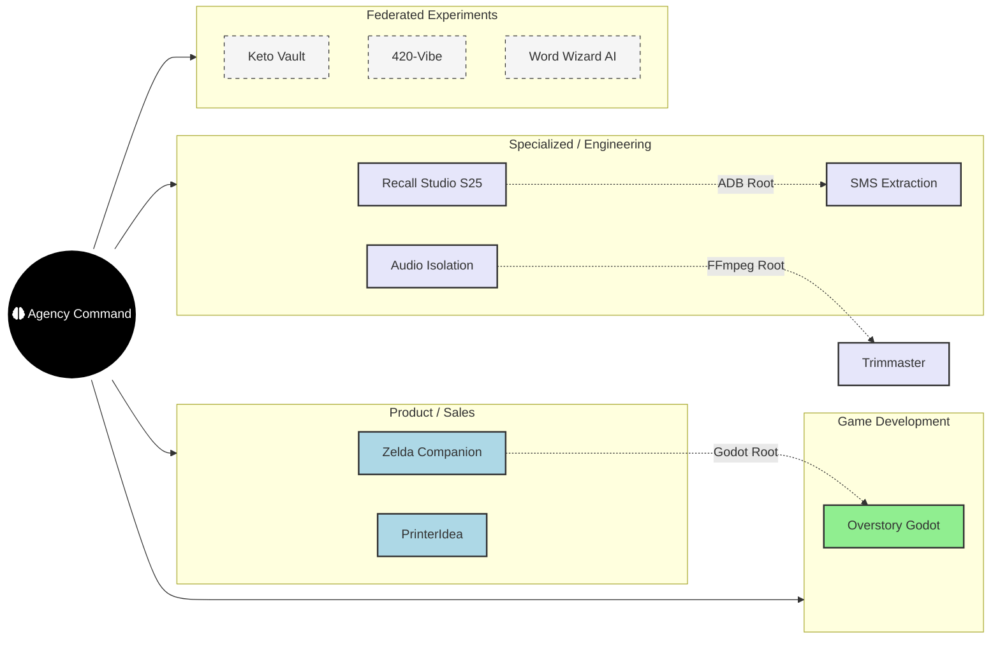

# 🗺️ Agency Command Master Mind Map

## 🗡️ The Samurai Schematic (Interactive)

### 🧠 Logic Intersections
- **Godot Suture**: Zelda & Overstory (Shared AssetRegistry logic).
- **ADB Forensic Utility**: Recall & SMS Extraction (Shared binary hooks).
- **Media Pipeline**: Audio Isolation & Trimmaster (Shared FFmpeg filters).
